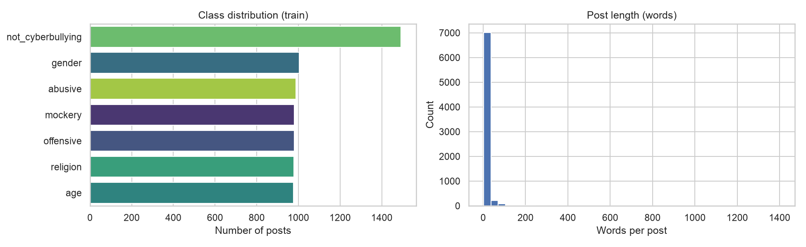
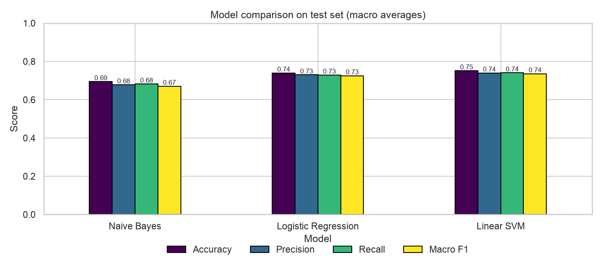
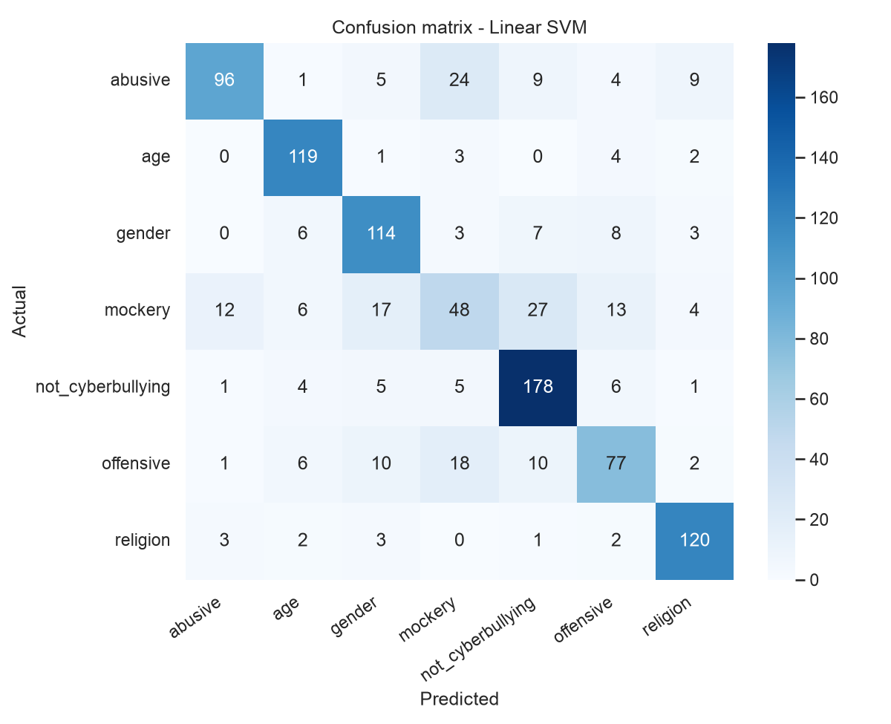
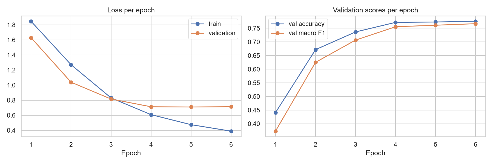
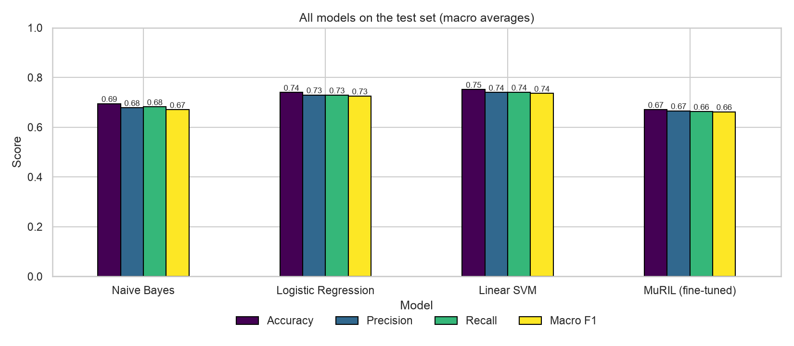
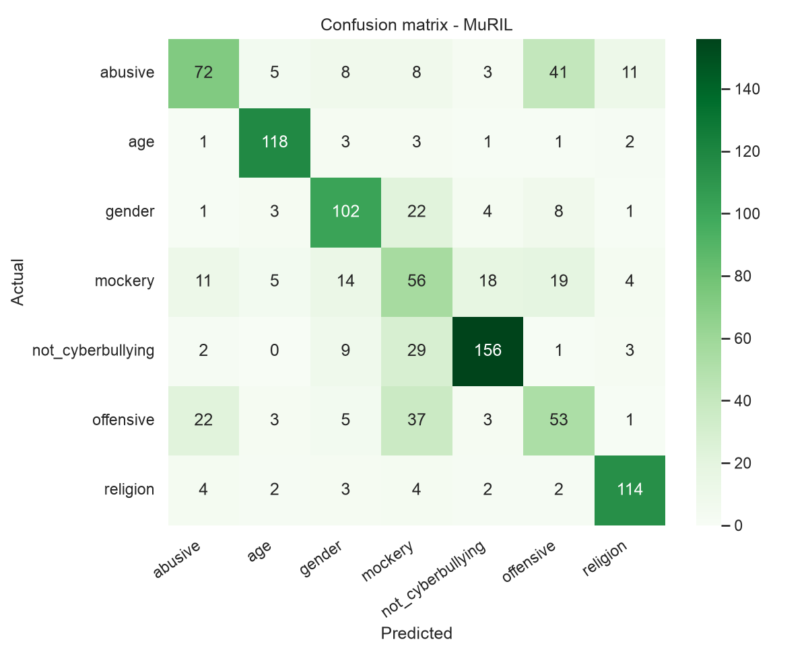

# Experiment 9 (Mini Project): Cyberbullying Detection in Hinglish Social Media

A multiclass NLP text classification project that detects **cyberbullying and its type** in code-mixed **Hinglish** (Hindi + English) social media posts.

> ⚠️ The dataset contains offensive and abusive language. It is used only for research and education.

**Team:** _add member names and roll numbers here_

---

## 1. Problem Statement

Given a short social media post written in Hinglish, classify it into one of **7 classes**:

| Class | Meaning |
|---|---|
| `not_cyberbullying` | Normal, harmless post |
| `gender` | Targets someone based on gender or sexuality |
| `religion` | Targets someone's religion |
| `age` | Targets someone's age |
| `abusive` | Contains abusive slurs |
| `offensive` | Rude or insulting content |
| `mockery` | Sarcasm and ridicule |

Hinglish is hard for standard NLP tools: it mixes two languages, is written in Roman script, and has no fixed spelling (`nahi` / `nai` / `nhi`).

## 2. Data Collection

- **Dataset:** [MC-Hinglish1.0](https://huggingface.co/datasets/sahinurlaskar/MC-Hinglish1.0) on Hugging Face (licence: CC BY-NC-SA 4.0)
- **Files:** `data/Train_data_MC-Hinglish1.0.csv` and `data/Test_data_MC-Hinglish1.0.csv`
- **Columns:** `tweets` (text), `cyberbullying_type` (label)

| Split | Posts |
|---|---|
| Train | 7,400 |
| Test | 1,000 |

The classes are fairly balanced (around 980 posts each, with about 1,490 `not_cyberbullying`). The average post has about 19 words.



## 3. Data Processing and Feature Extraction

**Cleaning** (the `clean_text()` function):
1. Remove 1 missing row and 7 duplicate rows
2. Lowercase the text
3. Remove URLs and `@mentions`, and keep the word from each `#hashtag`
4. Remove numbers, punctuation and emojis, keeping English and Devanagari letters
5. Shorten repeated characters (`sooooo` → `soo`)

**Tokenization:** split on whitespace and remove a small custom list of English and Hindi stop-words (`the`, `is`, `hai`, `ka`, `ki`, `aur`, …). No stemming is applied, because English stemmers break Romanized Hindi words.

**Features: TF-IDF** (about 102K features in total), combining two views:
- **Word n-grams (1–2):** words and short phrases
- **Character n-grams (2–5):** handle the spelling variations that are common in Hinglish

## 4. Model Training

All three models use the same TF-IDF features inside a scikit-learn `Pipeline`:

| Model | Settings |
|---|---|
| Multinomial Naive Bayes | `alpha=0.1` (baseline) |
| Logistic Regression | `C=10`, `class_weight="balanced"` |
| Linear SVM | `C=1`, `class_weight="balanced"` |

## 5. Evaluation and Results

The models are evaluated on the held-out **test set (1,000 posts)** using accuracy and macro-averaged precision, recall and F1:

| Model | Accuracy | Precision | Recall | Macro F1 |
|---|---|---|---|---|
| Naive Bayes | 0.695 | 0.679 | 0.682 | 0.671 |
| Logistic Regression | 0.740 | 0.730 | 0.729 | 0.726 |
| **Linear SVM** | **0.752** | **0.740** | **0.741** | **0.736** |



**Per-class F1 for the best model (Linear SVM):** religion 0.88, age 0.87, not_cyberbullying 0.82, gender 0.77, abusive 0.74, offensive 0.65, mockery 0.42.



**Observations**
- The **religion**, **age** and **gender** classes are easy to detect because they use clear keywords (`dharam`, `mandir`, `uncle`, `aunty`, `didi`).
- **Mockery** is the hardest class. Sarcasm depends on context and is often confused with `not_cyberbullying`, `abusive` and `offensive`.
- Linear models beat Naive Bayes by about 5–6 F1 points.

The notebook also shows the **top words per class** and a `predict()` function for trying the model on new sentences.

## 6. Model 4: Fine-tuned MuRIL (Transformer)

The classical models level off at about 75% accuracy: tuning C, n-gram ranges and ensembles adds only about 0.5 points, because word counts can't capture sarcasm (`mockery`). To improve on this, we fine-tuned **MuRIL** (`google/muril-base-cased`, 238M parameters). MuRIL is a BERT model from Google, pretrained on 17 Indian languages, **including Romanized Hindi**. The code is in `Experiment_9_MuRIL.ipynb`. The classical models in `Experiment_9.ipynb` are kept as the baseline.

**Preprocessing:** we only remove URLs and mentions, and keep stop-words, because the transformer uses context. MuRIL's own WordPiece tokenizer splits each post into sub-word tokens.

**Training setup (final run)**

| Hyperparameter | Value |
|---|---|
| Learning rate | 5e-5 (AdamW optimizer, linear decay, 10% warm-up) |
| Epochs | 6 (the best epoch is picked on the validation set) |
| Batch size | 32 |
| Max sequence length | 64 tokens (only 3.7% of posts are longer) |
| Weight decay | 0.01 |
| Validation | 10% of the training set, stratified by class |

**How we chose the learning rate and number of epochs**

The BERT authors (Devlin et al., 2019) recommend 2–4 epochs with a learning rate of 2e-5 to 5e-5. Fewer epochs than when training from scratch are enough because the model is already pretrained. We started there and let the validation curves guide us:

| Run | Learning rate | Epochs | Best val accuracy | Test accuracy | Test macro F1 | What happened |
|---|---|---|---|---|---|---|
| 1 | 3e-5 | 3 | 0.597 | 0.554 | 0.467 | **Underfitting**: validation was still rising every epoch and training loss stayed high (1.34) |
| 2 | 5e-5 | 6 | 0.776 | **0.671** | **0.662** | Validation levels off after epoch 4 (see the curves) |

In run 2, validation loss stops improving after epoch 4 while training loss keeps falling, so the model is starting to memorize the training data. Training for more epochs would only overfit, so 6 epochs is enough.



**Test results: all models**

| Model | Accuracy | Precision | Recall | Macro F1 |
|---|---|---|---|---|
| Naive Bayes | 0.695 | 0.679 | 0.682 | 0.671 |
| Logistic Regression | 0.740 | 0.730 | 0.729 | 0.726 |
| **Linear SVM** | **0.752** | **0.740** | **0.741** | **0.736** |
| MuRIL (fine-tuned) | 0.671 | 0.666 | 0.663 | 0.662 |



**Per-class F1 for MuRIL:** age 0.89, religion 0.85, not_cyberbullying 0.81, gender 0.72, abusive 0.55, offensive 0.43, mockery 0.39.



**Why didn't the transformer win?**
- **The test set is harder than the validation set for every model.** The SVM scores 0.82 on the same validation split but 0.74 on test, and MuRIL drops from 0.78 to 0.67. So part of the drop comes from the test set itself.
- **The dataset is small** (about 6.6K posts) for a 238M-parameter model. TF-IDF + SVM has far fewer parameters to fit and overfits less.
- **The classes depend on keywords.** Words like `dharam`, `aunty` and slurs largely decide the class, and the character n-grams of TF-IDF capture them very well. `mockery` and `offensive` stay hard for both approaches.
- **Training was limited:** one run of 6 epochs on a laptop GPU, with no hyperparameter search and no ensembling.

**Takeaway:** on a small, keyword-driven dataset, a well-tuned classical model can beat a large pretrained transformer. It also trains in seconds instead of about 14 minutes.

## 7. Project Structure

```
Experiment_9/
├── Experiment_9.ipynb      # Models 1-3: TF-IDF + NB / LR / SVM (baseline)
├── Experiment_9_MuRIL.ipynb # Model 4: fine-tuned MuRIL transformer
├── data/                   # train and test CSVs
├── results/                # saved plots, model_comparison.csv, all_models_comparison.csv
├── requirements.txt        # classical models (MuRIL also needs torch, transformers)
└── README.md
```

## 8. How to Run

```bash
cd Experiment_9
pip install -r requirements.txt
jupyter notebook Experiment_9.ipynb
```

Run all cells from top to bottom; `Experiment_9.ipynb` takes under a minute on a laptop.

`Experiment_9_MuRIL.ipynb` needs `pip install torch transformers` and a GPU. On Google Colab, choose **Runtime → Change runtime type → T4 GPU**; Apple Silicon (MPS) also works. Run `Experiment_9.ipynb` first, because the MuRIL notebook reads `results/model_comparison.csv` to build the comparison chart. The model weights (~950 MB) are downloaded automatically and are not saved to the repo. Plots are saved in `results/`. On Google Colab, upload the `data/` folder and create an empty `results/` folder next to the notebook.

## 9. Conclusion and Future Work

- **Best model: TF-IDF (word + character n-grams) + Linear SVM**, with **75.2% accuracy and 0.736 macro F1** on 7-class Hinglish cyberbullying detection.
- Fine-tuned **MuRIL** reached **67.1% accuracy and 0.662 macro F1**. Tuning the learning rate and number of epochs raised it from 55.4%, but it still did not beat the SVM on this small dataset.
- `religion` and `age` are easy for every model; `mockery` (sarcasm) and `offensive` are the hardest.

Ideas for future work:
- Run a proper hyperparameter search for MuRIL (learning rate, batch size, random seeds) and try other Indic models, such as **IndicBERT** and **HingBERT**
- Combine the SVM and MuRIL in an ensemble
- Normalize spelling variants (`nhi` → `nahi`) and use data augmentation for the hard classes
